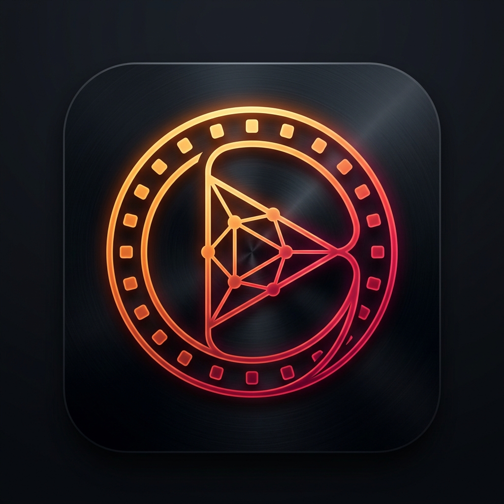
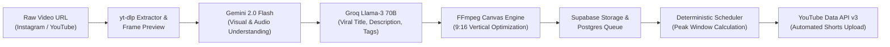

<div align="center">



# ReelMob

**Autonomous AI Short-Form Video Optimization, Scene Intelligence & Cloud Publishing Studio**

[](https://github.com/Bhuma005/ReelMob/actions/workflows/ci.yml)
[](https://fastapi.tiangolo.com)
[](https://reactjs.org)
[](https://supabase.com)
[](https://ai.google.dev/)
[](https://groq.com)
[](https://developers.google.com/youtube/v3)

[🚀 Live Demo](https://reelmob.onrender.com) • [✨ Features](#-key-features) • [🏛 Architecture](#-architecture--pipeline) • [⚡ Quickstart](#-getting-started) • [🔒 Security](#-security--oauth)

</div>

---

## 🌟 Overview

**ReelMob** is a production-grade automated media intelligence pipeline that transforms raw video content (Instagram Reels, YouTube Shorts, web clips) into high-retention, algorithm-optimized short-form videos and publishes them directly to **YouTube Shorts**.

Engineered with a **FastAPI** backend, **React 18** frontend, **Supabase PostgreSQL** persistence, and hybrid **Gemini + Groq AI**, ReelMob handles the entire lifecycle: from frame-by-frame visual analysis and 9:16 vertical re-framing to deterministic peak-hour scheduling and automated YouTube OAuth publishing.

---

## ✨ Key Features

- 👁️ **Multimodal Visual & Audio Inspection**: Uses **Google Gemini 2.0 Flash** to inspect key frames, extract visual narratives, detect on-screen actions, and transcribe audio/dialogue without heavy server-side GPU rendering.
- ⚡ **Sub-Second Viral Copy Generation**: Powered by **Groq Cloud (Llama-3 70B)** to generate high-CTR titles strictly under 60 characters, deep multi-paragraph SEO descriptions, and trending hashtag clusters.
- 📐 **Intelligent 9:16 Canvas Re-Framing**: Powered by **FFmpeg** with zero-loss direct stream copy for vertical videos, plus automated high-aesthetic blurred background padding for horizontal or non-standard aspect ratios.
- ⏰ **Deterministic Audience Retention Scheduling**: Mathematical scheduling engine based on audience consumption peak patterns (IST & global windows) enforcing a safe 2-video daily cadence cap.
- 🚀 **One-Click & Cloud Automated Publishing**: Direct integration with **YouTube Data API v3** with background worker claiming, token auto-refresh, and immediate publish bypass.
- 🛡️ **Durable Background Architecture**: Stateless API server with asynchronous jobs offloaded to pre-baked GHCR containers (`ghcr.io/bhuma005/reelmob-worker:latest`) and GitHub Actions pollers.
- 🔒 **Enterprise-Grade Token & Data Permanence**: OAuth refresh tokens securely persisted in Supabase with Row Level Security (RLS), graceful fallback, and soft-deletion permanence.

---

## 🏛 Architecture & Pipeline



---

## 🛠 Tech Stack

| Layer | Technologies |
| :--- | :--- |
| **Backend API** | Python 3.11 / 3.13, FastAPI, Uvicorn, Pydantic v2 |
| **Frontend UI** | React 18, Vite, Tailwind CSS, Lucide Icons, TanStack Query, Framer Motion |
| **AI Models** | Google Gemini 2.0 Flash (`google-genai`), Groq Cloud Llama-3 70B Versatile |
| **Video Engine** | FFmpeg, FFprobe, yt-dlp, Pillow, OpenCV |
| **Database & Storage** | Supabase (PostgreSQL 17 with RLS, Storage Buckets, Audit Logs) |
| **Automation & CI/CD** | GitHub Actions (`upload_poller`, `video_analysis`), GHCR Docker Worker |
| **Cloud Hosting** | Render (FastAPI Web Service), Supabase Cloud, GitHub Actions Runners |

---

## 🚀 Getting Started

### Prerequisites

- Python 3.11+
- Node.js 18+ and npm
- FFmpeg installed and available on system `PATH`
- A free [Supabase](https://supabase.com) project
- API keys: [Google Gemini](https://aistudio.google.com/) and [Groq Cloud](https://console.groq.com/)

### 1. Clone the Repository

```bash
git clone https://github.com/Bhuma005/ReelMob.git
cd ReelMob
```

### 2. Configure Environment Variables

Create a `.env` file in the project root:

```env
ENVIRONMENT=development
PORT=8000
SECRET_KEY=your-super-secret-key-32-chars-min
CORS_ORIGINS=http://localhost:5173,http://localhost:3000

# Supabase
SUPABASE_URL=https://your-project.supabase.co
SUPABASE_KEY=your-anon-key
SUPABASE_SERVICE_KEY=your-service-role-key

# AI Engines
GEMINI_API_KEY=your-gemini-api-key
GROQ_API_KEY=your-groq-api-key

# YouTube Data API OAuth
GOOGLE_CLIENT_ID=your-google-client-id.apps.googleusercontent.com
GOOGLE_CLIENT_SECRET=your-google-client-secret
GOOGLE_REDIRECT_URI=http://localhost:5173/auth/callback
```

### 3. Backend Setup

```bash
# Create and activate virtual environment
python -m venv venv
venv\Scripts\activate   # Windows
# source venv/bin/activate  # macOS/Linux

# Install dependencies
pip install -r requirements.txt

# Run backend server
python run.py
```

API will be running at `http://localhost:8000` (Swagger docs at `/docs`).

### 4. Frontend Setup

```bash
cd frontend-react
npm install
npm run dev
```

Dashboard will open at `http://localhost:5173`.

---

## 🧪 Testing & Verification

ReelMob maintains high test coverage across scheduler determinism, OAuth security, and state machines.

```bash
# Run backend test suite
pytest

# Run specific domain test suites
pytest backend/tests/test_oauth_security.py
pytest backend/tests/test_youtube_token_persistence.py
pytest backend/tests/test_on_demand_download.py
pytest backend/tests/test_ai_fallback_diagnostics.py
pytest backend/tests/test_deterministic_scheduler.py

# Run frontend build verification
cd frontend-react
npm run build
```

---

## 🔒 Security & OAuth Best Practices

- **Strict User Privacy**: ReelMob requests only necessary scopes (`youtube.upload`, `youtube.readonly`) and strictly complies with the [Google API Services User Data Policy](https://developers.google.com/terms/api-services-user-data-policy).
- **Encrypted Token Vault**: OAuth refresh tokens are stored in the PostgreSQL `oauth_tokens` table with Row-Level Security enabled.
- **Never Commit Secrets**: All API keys, service role credentials, and cookie session files are excluded via `.gitignore` and `.dockerignore`.

---

## 📄 License

This project is licensed under the MIT License — see the [LICENSE](LICENSE) file for details.
